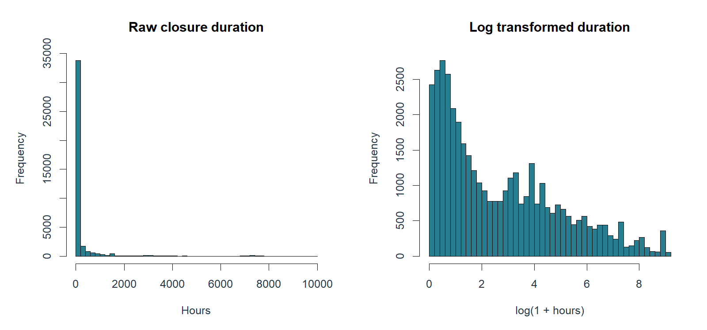
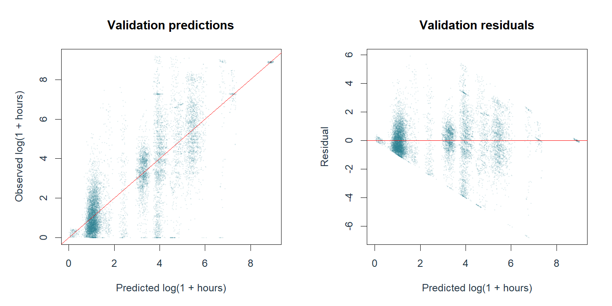
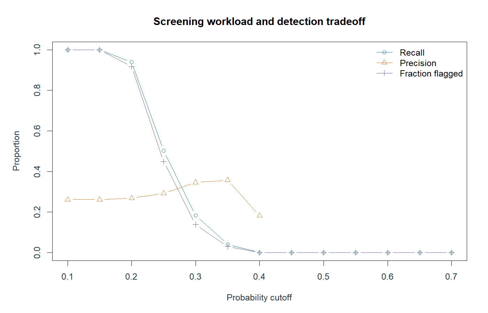
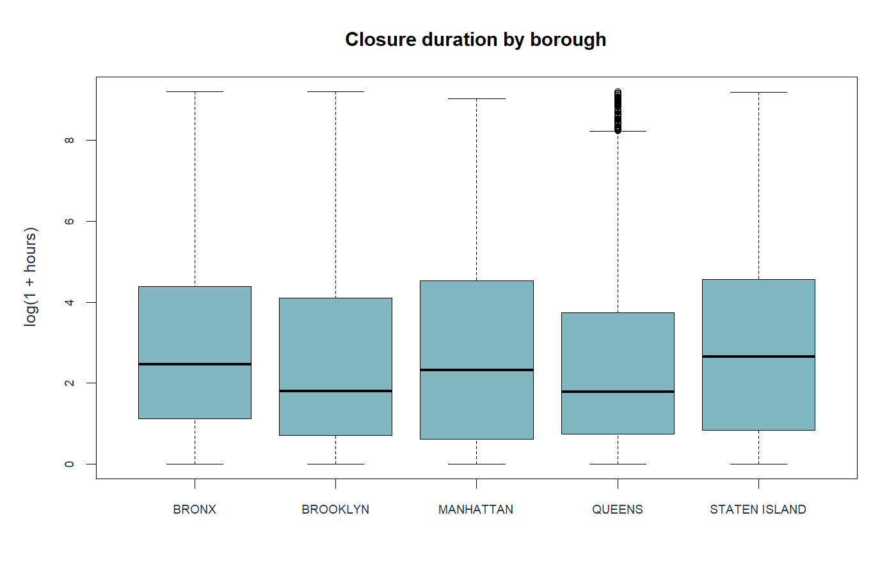

# When 74% Accuracy Detects Nothing: Lessons from an NYC 311 Service-Request Study

*An exploratory R-based study of 40,000 April 2025 service-request records*

## Abstract

Can the information available when a resident submits a service request help estimate its recorded closure time and identify unusually slow cases? I examined a supplied classroom sample of 40,000 NYC 311 requests created in April 2025, using descriptive statistics and holdout-tested linear and logistic regression in R. The findings expose a central challenge in applied analytics: an apparently strong summary metric can conceal a model that fails at the task for which it was built. The analysis is exploratory, not an evaluation of the City of New York or a deployed decision system.

## 1. Why this question matters

Imagine a resident reporting a broken streetlight or recurring noise. A city receives the request, routes it, and eventually records an administrative closure. Could a model flag requests likely to remain open unusually long, so that staff could review them earlier? Such a model would be useful only if its predictions were reliable, interpretable, and operationally fair. I approached the question through two related tasks: estimating elapsed hours to recorded closure and classifying requests as unusually slow relative to similar problem types.

## 2. Data and measurement

The supplied dataset contains 40,000 records, all marked Closed. Of these, 332 lacked a usable closure timestamp, leaving 39,668 observations for duration-based analysis. I measured elapsed hours between creation and recorded closure. This is an administrative timestamp difference, not a verified measure of problem resolution, resident satisfaction, or staff productivity. Because the sample contains only records marked Closed, it cannot characterize the experience of all incoming requests, particularly those still open. The sample should not be treated as representative of NYC 311 activity citywide.

## 3. Finding one: the average hides a long tail

The median recorded closure time was 6.68 hours, but the mean was 251.36 hours—approximately 10.5 days. The 75th percentile was 66.00 hours, and 2,930 observations exceeded 30 days. A typical request and the arithmetic average therefore tell very different stories. These long durations are not automatically errors: without independent evidence, removing them would hide precisely the cases that a delay-screening study is supposed to examine. The analysis retained zero-hour and long-duration records and used log(1 + hours) for regression.

*Figure 1. Distribution of recorded closure durations in the supplied sample; note the long right tail.*

## 4. Study design: predict only from information available at submission

The analysis used a reproducible 70/30 training-validation split. Predictors included problem type, borough, submission channel, weekday, and cyclic hour-of-day features. Closure timestamps, resolution descriptions, and other information only available after submission were excluded from model inputs to reduce target leakage. Linear regression estimated log-transformed closure hours. A separate logistic regression estimated whether a request would exceed the 75th-percentile duration for its problem type, with a training-derived global fallback for sparse categories. This is a study-defined relative delay threshold, not an official NYC service-level deadline.

## 5. Finding two: regression performance depends on the scale

The linear model achieved validation RMSE of 1.3089 in log(1 + hours) units, compared with 2.2388 for the training-mean baseline, and predictive R-squared of 0.6582. Those statistics describe performance on the transformed scale; they do not mean that individual closure times can be predicted accurately in hours. When predictions were converted back into hours using a training-residual smearing adjustment, validation RMSE was 1,373.18 hours versus 970.97 hours for the mean baseline. The model's hour-scale MAE was lower (316.65 versus 392.31 hours), illustrating how different loss functions can favor different models in a heavily skewed distribution. An operational decision should be judged in the units and error costs that actually matter.

*Figure 2. Diagnostic plots for the fitted linear regression; transformed-scale fit does not guarantee accurate hour-scale forecasts.*

## 6. Finding three: 73.83% accuracy, but zero slow cases detected

The logistic classifier's validation AUC was approximately 0.5542, indicating weak ability to rank slow cases above non-slow cases. At the conventional probability cutoff of 0.50, it predicted no slow cases at all: accuracy was 73.83%, yet recall was 0%. This is possible because most validation observations did not meet the study-defined slow threshold. A classifier that simply avoids positive predictions can appear accurate while providing no useful early warning. At a 0.25 cutoff, recall improved to 50.24%, but precision was only 29.23%, accuracy was 55.14%, and 44.99% of validation cases were flagged. In practical terms, a lower cutoff catches more genuinely slow cases at the cost of substantially more false alerts and review workload.

*Figure 3. Classification trade-offs across probability cutoffs, including the increase in alerts as the threshold falls.*

## 7. Finding four: the same cutoff behaves differently across boroughs

At the 0.25 cutoff, the share of validation requests flagged by the model varied sharply: 99.43% in the Bronx and 1.17% in Staten Island, with other boroughs between those extremes. These figures describe predicted alert rates, not actual service failure rates. They do not establish discrimination, unequal staff performance, or a causal borough effect. They do show that a single overall accuracy or recall statistic is insufficient for assessing how a model would affect different groups. Before deployment, a responsible evaluation would examine request mix, calibration, group-specific error rates, workload, and the consequences of false positives and false negatives.

*Figure 4. Descriptive closure-duration differences by borough; these are associations, not causal effects.*

## 8. What the research does—and does not—show

The study supports three bounded conclusions. First, recorded closure times are highly right-skewed in this supplied closed-request sample. Second, transformed-scale fit can be misleading when interpreted as accurate hour-scale forecasting. Third, classification accuracy can mask an ineffective delay-screening system. The work does not demonstrate that borough causes delays, that a closed ticket means a resolved problem, or that the models are ready for live prioritization. Results were evaluated on one holdout split from one classroom sample, without a prospective temporal test or an operational cost study.

## 9. Implications and next steps

For a future research iteration, I would obtain a well-documented sample that includes open and closed requests, use a time-based validation split, consider time-to-event methods that accommodate unresolved cases, and benchmark against simple rules before adding model complexity. I would also test calibration and group-specific errors and consult operational staff about acceptable false-alert volume. For now, the descriptive analysis is useful for identifying questions about workflow and data quality, while the classifier should not automatically prioritize or deprioritize resident requests.

## Conclusion

This project changed how I interpret predictive performance. The central lesson is not that modeling public services is futile; it is that predictive analytics becomes credible only when the outcome is clearly defined, leakage is controlled, error is evaluated on a meaningful scale, and model behavior is examined beyond a headline score. In this case, 73.83% accuracy concealed zero detection of slow cases. Discovering that limitation is itself a substantive analytical finding.

## Data, reproducibility, and disclosure

Analysis was performed in R using a supplied April 2025 NYC 311 classroom sample. Reproducible scripts, aggregate result tables, and figures are documented in the accompanying project repository. The original row-level sample is not included in the public release pending source, privacy, and redistribution review; reproducing the exact numbers requires access to that same sample. This is an independent educational analysis and is not endorsed by NYC government. Tool assistance may be acknowledged separately where required by institutional or publication policies.
